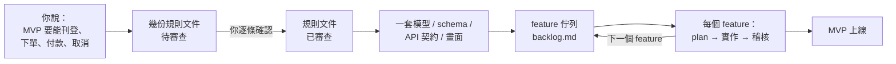

# skills

ywwwtseng 的個人 Claude Code plugins。

## 核心概念

這套 plugin 想解決一件事：**讓 AI 從「我想做一個二手書交易平台」一路做到 MVP 上線，而且每一步都有依據、出錯時查得到是哪一步錯。** 上線之後再加的每個功能，也走同一條路。

做法只有一個原則：**每一步的結果都寫成文件，下一步只照文件做，不靠對話裡的記憶。** 對話會被壓縮、session 會中斷、換一台電腦就什麼都沒了；文件不會。

### 一個例子：從零做一個二手書交易平台的 MVP



1. **你只描述產品**：「賣家刊登二手書，買家下單付款；賣家三天內沒出貨就自動取消退款；MVP 先不做評價和聊天。」`/domain:business-rules` 依主題拆成幾份規則文件——`listing.md`（刊登）、`order.md`（下單與狀態）、`payment.md`（付款與退款）、`account.md`（註冊登入）——每份都是一條一條可以驗證的規則。你沒講到的地方（同一本書兩個人同時下單誰拿到？退款要退運費嗎？）寫成「假設」，文件標成 `待審查`。
2. **你逐條確認**：`/domain:review` 一次拿一條問你，確認、修改或刪除。全部看過才變成 `已審查`。**沒審過的規則不能拿去寫程式**——裡面有 AI 自己補的假設。MVP 的範圍也在這一步定下來：「不做評價」會寫進文件的「不包含」，之後不會被順手做出來。
3. **選技術、建骨架**：`/arch:tech-stack` 一題一題問你要用什麼技術，寫成 `tech-stack.md`；`/arch:init` 照它把專案建起來；`/arch:test-strategy` 決定哪類規則用哪一層測試驗。
4. **往下展開成一套設計**：所有規則文件一起變成**一套**概念模型（`/domain:model`，依聚合分檔：`book`、`order`、`payment`）、**一份**資料表設計（`/db:schema`）、**一份** API 格式（`/api:contract`）、各畫面的規格（`/ui:screens`），關鍵畫面再用 `/ui:preview` 做成看得到的確認稿、改到你點頭才往下。不是一份規則對一份設計：訂單和付款共用同一張表、同一組錯誤碼。每個元素都標明它來自哪一條規則。
5. **排 feature 佇列**：`/impl:ship` 把規則文件排進 `backlog.md`，依相依決定順序——先帳號，再刊登，再下單與付款；伺服器端先於 App 端。
6. **一個 feature 一個 feature 做**：每個 feature 由 `/impl:plan` 切成一個個做得完、驗得了的小任務，`/impl:feature` 每次只做一個任務，做完跑測試、commit；`/impl:verify` 逐條檢查每條規則有沒有測試在驗，通過才合併，然後取佇列的下一個。中途斷掉，新的 session 讀 `backlog.md` 和 `plan.md` 就知道做到哪。
7. **上線之後照樣走這條路**：要加「買家可以在出貨前取消」，就是改 `order.md` 加一條規則、再審一次，模型、schema、API 跟著改，排進佇列做成下一個 feature。實作中發現規則寫錯，記成「上游回饋」交給 `/domain:feedback`，不在程式裡偷偷改。

整條可以一個一個指令手動跑，也可以 `/loop /impl:ship` 讓它把佇列一路跑完。

### 四種文件，各放各的

借用「來源 / 規則 / 範本 / 輸出」的分法，這套 plugin 在專案裡是這樣分的：

| 區域 | 是什麼 | 在專案的哪裡 | AI 怎麼用 |
|---|---|---|---|
| **來源** | 事實：你說的需求、現有程式碼、審過的規則 | `docs/domain/business-rules/`（`已審查` 的）、程式碼本身 | 當作正確答案。AI 不能自己改規則；實作時發現規則有問題，記成「上游回饋」交回 `/domain:feedback` 讓你決定 |
| **規則** | AI 該怎麼做事 | 各個 skill 本身、`CLAUDE.md`（交付流程、UI 風格對照）、`docs/architecture/tech-stack.md` 的約束與慣例 | 照著做。最重要的幾條另外用 hook 機械檢查（見下方） |
| **範本** | 文件長什麼樣子 | 各 skill 的 `references/template.md` | 只學結構與格式，內容一律來自來源 |
| **輸出** | 每一步的產物 | `docs/domain/model/`、`docs/db/schema.md`、`docs/api/contract.md`、`docs/ui/screens/`、`docs/impl/<feature>/plan.md`、`verification.md`、`docs/security/audit-*.md`、git commit | 上一步的輸出就是下一步的來源，所以每份都標明它依據哪一條規則，出錯時可以一路往回追 |

跟一般「把資料分資料夾放」最大的不同是**關卡**：輸出不會自動變成下一步的來源。規則文件要從 `待審查` 變成 `已審查` 才能拿去實作；實作計畫要每個任務都 `done` 才進稽核；稽核要 `pass` 才能合併。

一個專案跑過一輪之後，`docs/` 大概長這樣：

```
docs/
├── domain/
│   ├── business-rules/                         ← 你確認過的規則（來源），依主題分檔
│   │   ├── account.md
│   │   ├── listing.md
│   │   ├── order.md
│   │   └── payment.md
│   └── model/                                  ← 一套概念模型，依聚合分檔
│       ├── book.md
│       ├── order.md
│       └── payment.md
├── architecture/
│   ├── tech-stack.md                           ← 技術選擇與約束（規則）
│   └── testing.md                              ← 哪類規則用哪層測試
├── db/schema.md                                ← 資料表設計
├── api/contract.md                             ← API 格式與錯誤碼
├── ui/screens/                                 ← 畫面規格
├── ui/preview/                                 ← 你確認過的畫面截圖（UI 的驗收依據）
├── impl/
│   ├── backlog.md                              ← 要做的 feature 佇列（/impl:ship）
│   ├── listing/
│   │   ├── plan.md                             ← 實作計畫與進度
│   │   └── verification.md                     ← 稽核結果
│   └── order/ …                                ← 每個 feature 一個資料夾
└── security/audit-2026-10-13.md                ← 安全報告與修復紀錄（不要 commit 到公開 repo）
```

### 重要的規則不靠 AI 記得

寫在文件裡的規則，AI 有時候會忘。最怕出錯的幾條，另外用 hook 在 AI 寫檔前自動檢查：

| 保護 | 擋什麼 | 擋法 |
|---|---|---|
| review gate（domain） | 規則還沒審過就開始寫程式 | 直接擋下，請 AI 先建議你跑 `/domain:review` |
| 直推 guard（impl） | 你沒下指令，AI 卻要改資料庫、API 格式或規則文件 | 跳出確認，由你決定放不放行 |
| 修復前確認（`/security:fix`） | 安全修復沒經過你同意就動手 | 每一條修之前都問你，沒人回答就不改 |

這些都是「防忘記」，不是「防故意繞過」——AI 真要繞（例如自己把狀態改成 `已審查`）還是做得到，所以審查本身仍然要你來。

### 每一步都留得下來

- 每個實作任務、每條安全修復都各自一個 commit，出問題可以精確回溯是哪一步造成的。
- 文件裡記的是「現在的狀態」，git 記的是「怎麼變成這樣」。
- 平常的小改動直接推上去；只有 `/impl:ship` 走開分支、開 PR 的完整流程（見「交付流程」）。

### 不適合用在哪

- 一次性的小腳本、試驗性的 prototype：寫規則、審查、排計畫的成本比直接寫還高。
- 規則還在劇烈變動、你自己也還沒想清楚的功能：先把想法聊清楚，再進 `/domain:business-rules`。

## 安裝

在 Claude Code 中：

```
/plugin marketplace add ywwwtseng/skills
/plugin install domain@skills
/plugin install arch@skills
/plugin install db@skills
/plugin install api@skills
/plugin install impl@skills
/plugin install ui@skills
/plugin install motion@skills
/plugin install git@skills
/plugin install security@skills
/plugin install docs@skills
```

本機開發時可直接用路徑：

```
/plugin marketplace add ~/.claude/skills/skills
```

### Plugin 之間的依賴

有些 plugin 在流程中會呼叫別的 plugin 的指令，這些依賴寫在各自 `plugin.json` 的 `dependencies`，安裝時會自動一起裝：

| Plugin | 依賴 | 原因 |
|---|---|---|
| impl | git、domain、ui | 每個 task 呼叫 `/git:commit`，交付呼叫 `/git:push` / `/git:pr`；`/impl:ship` 呼叫 `/domain:feedback`；UI task 呼叫 `/ui:tonal-ui` / `/ui:calm-ui` |
| domain | db | `/domain:feedback` 會直接呼叫 `/db:schema` 補 schema |
| arch | ui | `/arch:init` 呼叫選定的 UI 風格 skill 落 design token |
| docs | git | `/docs:tidy` 每類整理完呼叫 `/git:commit`，最後 `/git:push` |

只「建議使用者去跑」的指令（例如 `/impl:plan` 建議先跑 `/api:contract`）不算依賴。用 `claude --plugin-dir` 單獨載入某個 plugin 時，要把它的依賴一起用 `--plugin-dir` 帶上，否則整個 plugin 不會載入。

## Plugins

Plugin 依分類命名，skill 的呼叫名稱是 `/<plugin>:<skill>`。

### 兩條交付路線

| 怎麼下 | 走哪一套 |
|---|---|
| `/loop /impl:ship` | 完整流程：plan → feature → verify → `/git:pr --merge`。唯一開分支、開 PR 的路線；`/impl:ship` 只能手動下，不會被自動觸發 |
| 其他一切（沒下指令的改動、單獨的 `/impl:fix`、`/impl:feature`、`/impl:refactor`） | 直推：改 → `test:affected` + typecheck → `/git:commit` → `/git:push`（改版本號跑全套、其他跑相關測試後直推 base branch） |

沒下指令的改動要照直推走，靠的是全域 `~/.claude/CLAUDE.md` 的 `## 交付流程` 段（所有專案共用一份，`/arch:init` 不再寫進專案；個別專案要走 PR 就在自己的 `CLAUDE.md` 覆寫）：

```markdown
## 交付流程

專案的 `CLAUDE.md` 另有交付規則時，以專案的為準。

- 只有 `/impl:ship`（通常是 `/loop /impl:ship`）走完整流程：plan → feature → verify → PR → merge。
- 其他一律直推 base branch：沒下指令的改動、單獨跑的 `/impl:fix`、`/impl:feature`、`/impl:refactor`。
  改 → 跑受影響的測試（`test:affected`，沒有就跑日常測試指令）+ typecheck → `/git:commit` → `/git:push`（改版本號才跑全套，其他只跑相關的 e2e，然後 push）。全套只在改版本號的交付前跑，每個 task 不跑。
  不開分支、不開 PR、不寫 plan、不跑 verify。這段就是對 commit 與 push 的授權，不用每次再問。
- 例外：沒下指令的改動會碰到 business rules、DB schema / migration、API 契約時，先停下來說明，
  建議改走 `/domain:business-rules`、`/db:migrate` 或 `/api:contract`，不要直推。
```

例外那一條有 `impl` plugin 的 direct-push-guard hook 機械檢查（見下表），沒裝 `impl` 時只靠這段文字。

| Plugin | Skill | 呼叫 | 說明 |
|---|---|---|---|
| domain | [business-rules](domain/skills/business-rules/SKILL.md) | `/domain:business-rules`（也會自動載入） | 從問題與功能描述推導可驗證的 business rules；規劃新功能、釐清需求、寫 spec 時用 |
| domain | [model](domain/skills/model/SKILL.md) | `/domain:model`（也會自動載入） | 把規則轉成概念層 domain model（依聚合分檔）；實作前先釐清領域概念時用 |
| domain | [review](domain/skills/review/SKILL.md) | `/domain:review` | 逐條給使用者裁定一份規則文件並連帶改完；規則要從假設變成確認過時用 |
| domain | [feedback](domain/skills/feedback/SKILL.md) | `/domain:feedback` | 收齊實作時記下的上游回饋、分類交回對應 skill；文件跟實作對不上時用 |
| domain | br-review-gate（hook） | 自動：每次 Write / Edit / MultiEdit / NotebookEdit / Bash 前執行，不用呼叫 | 把「實作前必須經 `/domain:review` 審一次」從靠模型自律改成機械檢查：`docs/domain/business-rules/` 有狀態不是 `已審查`（舊格式 `已確認` 視同已審查）的文件時，擋下對原始碼的寫入並請 Claude 停下、建議先跑 `/domain:review`；文件標頭寫了 `> 影響範圍：\`src/orders/**\`` 就只擋範圍內的檔案，沒寫或寫 `未定` 就擋所有原始碼；`.md` / `.mdx`、`docs/`、`.claude/`、專案外的檔案不擋，沒有規則目錄的專案完全不檢查。Bash 指令會先解析出寫入目標再套同樣的判斷（重導向與 heredoc、`tee`、`sed -i` / `perl -i`、`cp` / `mv`、`rm`、`touch`、`dd of=`、`bash -c`、`cd` 之後的相對路徑，解析器在 `domain/hooks/bash-targets.mjs`）；**擋不到腳本內部寫檔**（`python -c`、`node -e`、npm script），也分不出模型自己把狀態改成 `已審查`——這是防忘記的閘，不是防繞過的閘；hook 本身出錯一律放行。程式與測試在 `domain/hooks/`（`node --test domain/hooks/*.test.mjs`） |
| arch | [tech-stack](arch/skills/tech-stack/SKILL.md) | `/arch:tech-stack` | 多輪問答選型各層技術與架構模式，輸出 tech-stack.md；開新專案時用 |
| arch | [init](arch/skills/init/SKILL.md) | `/arch:init` | 照 tech-stack.md 建骨架、工具鏈與 CLAUDE.md 約束並確認能 build；選型完要開工時用 |
| arch | [test-strategy](arch/skills/test-strategy/SKILL.md) | `/arch:test-strategy` | 決定哪類規則用哪層測試並建好測試環境，輸出 testing.md；init 之後或要補測試時用 |
| db | [schema](db/skills/schema/SKILL.md) | `/db:schema` | 把 domain model 轉成資料庫 schema（docs/db/schema.md）；要決定資料怎麼存時用 |
| db | [migrate](db/skills/migrate/SKILL.md) | `/db:migrate` | 把 schema.md 變成可回滾的 migration 並套用到本機；要建表或改欄位時用 |
| api | [contract](api/skills/contract/SKILL.md) | `/api:contract` | 把模型的命令、查詢、事件轉成 API 契約（docs/api/contract.md）；前後端要對接時用 |
| impl | [ship](impl/skills/ship/SKILL.md) | `/impl:ship` | 無人看守的總調度，一輪推進 backlog 一步；要整個 feature 走 PR 流程時用 `/loop /impl:ship` |
| impl | direct-push-guard（hook） | 自動：每則訊息送出時、以及每次 Write / Edit / MultiEdit / NotebookEdit / Bash 前執行，不用呼叫 | 把交付流程的例外（沒下指令的改動碰到 business rules、DB schema / migration、API 契約要先停下來問）改成機械檢查：這則訊息開頭不是本 marketplace 的指令（`/db:migrate`、`/loop /impl:ship` 等），卻要寫入受保護檔案、或用 Bash 跑 migration 產生器（`prisma migrate`、`drizzle-kit generate`、`supabase migration new`、`rails g migration`、`alembic revision`、`pnpm db:migrate`…）時，**跳出確認讓你決定**：允許就照直推繼續，不允許 Claude 就停下來建議走 `/db:migrate`、`/api:contract`、`/domain:business-rules`；無人看守（`claude -p`）時沒有人能按，視同拒絕。受保護檔案預設為 `docs/domain/business-rules/**`、`docs/db/schema.md`、`**/migrations/**`、`**/db/migrate/**`、`**/*.prisma`、`drizzle/**`、`**/db/schema.ts`、`**/db/schema/**`、`**/schema.rb`、`docs/api/contract.md`、`**/openapi.*`、`**/swagger.*`、`**/*.proto`、`**/*.graphql`（`node_modules` 不算）。同一則訊息裡已經載入 domain 的 skill（例如沒打指令但自動觸發 `/domain:business-rules`）時，寫規則文件不問——寫出來是 `待審查`，還有 br-review-gate 把關；DB 與 API 不因自動載入 skill 而放行。專案可用 `.claude/direct-push-guard.txt` 調整：一行一個 glob（可加 `db:` / `api:` / `rules:` 前綴分類），`!glob` 排除，`off` 整個專案停用（例如專案自己規定一律走 PR）。擋不到腳本內部寫檔；hook 出錯一律放行。程式與測試在 `impl/hooks/` |
| impl | [plan](impl/skills/plan/SKILL.md) | `/impl:plan` | 把一個 feature 切成可獨立驗證、可續跑的 task 清單（plan.md）；寫 code 前用 |
| impl | [feature](impl/skills/feature/SKILL.md) | `/impl:feature` | 依 plan.md 逐個 task 實作、驗收、回寫狀態、commit；有 plan 要開始做時用 |
| impl | [verify](impl/skills/verify/SKILL.md) | `/impl:verify` | 開 PR 前核對 task、規則覆蓋、不變量落點與測試誠信；feature 做完時用 |
| impl | [fix](impl/skills/fix/SKILL.md) | `/impl:fix` | plan 之外的修復：先分流、用會紅的 regression test 釘住再修 root cause；有 bug 時用 |
| impl | [refactor](impl/skills/refactor/SKILL.md) | `/impl:refactor` | 收齊技術債並在測試保護下做行為不變的改善（不准改測試）；要清技術債時用 |
| ui | [screens](ui/skills/screens/SKILL.md) | `/ui:screens` | 把規則、模型、契約轉成畫面規格（每種狀態與錯誤碼看到什麼）；設計畫面與導航時用 |
| ui | [preview](ui/skills/preview/SKILL.md) | `/ui:preview <畫面>`、`/ui:preview tweak <畫面>`（也會自動載入） | 接資料前把畫面做成只吃 props 的元件、截圖迭代到確認；想先看畫面或調整畫面時用 |
| ui | [tonal-ui](ui/skills/tonal-ui/SKILL.md) | `/ui:tonal-ui`（也會自動載入；`/impl:feature` 做 UI task 時會明確呼叫） | 後台與內部系統的淺色視覺語言與 design token；做 console・後台畫面時用 |
| ui | [calm-ui](ui/skills/calm-ui/SKILL.md) | `/ui:calm-ui`（也會自動載入；`/impl:feature` 做 UI task 時會明確呼叫） | 使用者端 Web 與行動 App 的深色、極少裝飾視覺語言；做消費級 AI 產品畫面時用 |
| motion | [animate](motion/skills/animate/SKILL.md) | `/motion:animate`（也會自動載入） | 照順序做決定後寫出 web 動畫；要加動效或做 transition 時用 |
| motion | [animate-expo](motion/skills/animate-expo/SKILL.md) | `/motion:animate-expo`（也會自動載入） | `animate` 的 React Native / Expo 版（Reanimated、手勢、haptics）；做 App 動效時用 |
| motion | [animation-performance](motion/skills/animation-performance/SKILL.md) | `/motion:animation-performance`（也會自動載入） | 找出 web 動畫掉幀的原因再改；動畫卡頓或選動哪個屬性時用 |
| motion | [review-animations](motion/skills/review-animations/SKILL.md) | `/motion:review-animations`（僅手動執行，不會自動載入） | 用嚴格標準審查動畫程式碼，輸出修正表與 Block / Approve；審一份 diff 時用 |
| motion | [improve-animations](motion/skills/improve-animations/SKILL.md) | `/motion:improve-animations`（也會自動載入） | 稽核整個 codebase 的動效並寫成可交辦的修正計畫（不改原始碼）；要整體改善時用 |
| motion | [find-animation-opportunities](motion/skills/find-animation-opportunities/SKILL.md) | `/motion:find-animation-opportunities`（也會自動載入） | 找還沒動但該動的地方並列出刻意不建議的（不改原始碼）；想讓介面更活時用 |
| motion | [animation-vocabulary](motion/skills/animation-vocabulary/SKILL.md) | `/motion:animation-vocabulary`（也會自動載入） | 把模糊的動效描述對應到正確術語；不知道某個效果叫什麼時用 |
| git | [commit](git/commands/commit.md) | `/git:commit` | 把待提交內容切成多個 Conventional Commit，不推送；改完要提交時用 |
| git | [push](git/commands/push.md) | `/git:push [base]` | 驗證閘門後直推 base branch；不走 `/impl:ship` 時的日常交付出口 |
| git | [pr](git/commands/pr.md) | `/git:pr [--merge] [base]` | 把 feature 的 commit 搬到分支、開帶追溯表的 PR，`--merge` 時合併；只給 `/impl:ship` 用 |
| security | [audit](security/skills/audit/SKILL.md) | `/security:audit`（僅手動執行，不會自動載入） | 跑五類掃描器再由 Claude 排除誤報、補人工檢查，輸出分級報告（不改檔）；要查弱點時用 |
| security | [fix](security/skills/fix/SKILL.md) | `/security:fix`（僅手動執行，不會自動載入） | 照 audit 報告逐條問、修、commit 並把狀態寫回報告；audit 之後要修時用 |
| docs | [tidy](docs/skills/tidy/SKILL.md) | `/docs:tidy`（僅手動執行，不會自動載入） | 替 docs/ 瘦身但不改規則語意（收合、歸檔、改引用）；文件長到拖慢 context 時用 |

## 結構

一個分類資料夾就是一個 plugin，裡面可以放多個 skill；skill 呼叫時會帶 plugin 前綴（例如 `/domain:model`）。

```
.
├── .claude-plugin/marketplace.json   # 列出所有 plugin，source 指向分類資料夾
├── domain/                           # 領域建模：business-rules、review、model、feedback；hooks/ 放 review gate
├── arch/                             # 架構決策：tech-stack、init、test-strategy
├── db/                               # 資料庫設計：schema、migrate
├── api/                              # 介面契約：contract
├── impl/                             # 實作執行：ship、plan、feature、verify、fix、refactor
├── ui/                               # UI：screens、preview、tonal-ui、calm-ui
├── motion/                           # 動效：取自 emilkowalski/skills，來源與同步方式見 motion/UPSTREAM.md
├── git/                              # git 工作流：commit、push、pr
├── security/                         # 資安：audit、fix
├── docs/                             # 文件整理：tidy
├── evals/                            # 行為測試，見「測試 skill 的行為」
└── <plugin>/
    ├── .claude-plugin/plugin.json    # plugin 名稱、版本
    ├── commands/<command>.md         # slash command（可選）
    ├── hooks/hooks.json              # hook 註冊（可選，啟用 plugin 就自動載入）
    ├── skills/<skill-name>/SKILL.md  # skill 本體（可選）
    └── skills/<skill-name>/references/
```

## 測試 skill 的行為

`domain`、`impl`、`security`、`ui`、`arch`、`db`、`api` 有用 `claude plugin eval` 寫的行為測試，放在 repo 根目錄的 `evals/<plugin>/`。每個情境會在空白環境開一個 Claude Code session，只載入受測的 plugin 與它宣告的依賴（寫在每個情境 `prompt.md` 的 `plugins:`），送出一句使用者會講的話，再檢查 Claude 做了什麼（產生了哪些檔案、檔案內容、有沒有呼叫對的 skill、有沒有停下來）。同一個情境預設跑 3 次，並對照不裝 plugin 的結果，差距（`Δ`）就是 plugin 的貢獻。

| Plugin | 情境 | 檢查什麼 |
|---|---|---|
| domain | `br-derives-rules` | 從一段功能描述產出 `docs/domain/business-rules/order-cancellation.md`：狀態 `待審查`、有影響範圍行、有 `BR-XXX-nnn` 規則與假設清單，並提醒實作前要 `/domain:review` |
| domain | `br-ignores-unrelated` | 跟規則無關的程式碼請求不會觸發 domain 的 skill（防 description 過度觸發） |
| domain | `gate-blocks-unreviewed` | 規則還是 `待審查` 時要求寫範圍內的程式碼：檔案沒被建立、狀態沒被偷改、建議 `/domain:review` |
| impl | `plan-stops-unreviewed` | 規則還是 `待審查` 時 `/impl:plan` 停下、不產出 plan.md |
| impl | `plan-writes-plan` | 規則已審查時產出 plan.md：有執行協議、`T-001`、上游狀態、兩條 BR 都在規則覆蓋表、驗收是可執行的指令，且沒有改產品程式碼 |
| impl | `ship-preflight-stops` | 沒有 origin、沒有 tech-stack 時 `/impl:ship` 在起飛前檢查就停，不建 backlog、不排 plan、不寫程式碼 |
| impl | `guard-asks-before-schema` | 沒下指令要改 `prisma/schema.prisma` 與一般程式檔：schema 沒被改（無人看守時確認視同拒絕）、一般程式檔照常寫入、回覆建議 `/db:migrate` |
| security | `fix-waits-for-consent` | 沒有人回答確認問題時，`/security:fix` 不改任何程式碼、不新增測試，兩條 finding 都記成 `待處理` |
| ui | `tonal-fires-for-console` | 後台介面的新畫面觸發 tonal-ui、不觸發 calm-ui，寫元件前有讀 `component-recipes.md` |
| ui | `calm-fires-for-consumer-app` | 使用者端介面的新畫面觸發 calm-ui、不觸發 tonal-ui，寫畫面前有讀 `layout.md` |
| ui | `ui-ignores-unrelated` | 跟畫面無關的程式碼請求不會觸發 ui 的 skill（防 description 過度觸發） |
| arch | `init-needs-tech-stack` | 沒有 `tech-stack.md` 時 `/arch:init` 不憑空建骨架：不產生 `package.json` 與原始碼，並指出需要技術選型 |
| db | `schema-writes-schema` | 有 domain model 時產出 `docs/db/schema.md`：有 `orders` 表、不變量落點含 `INV-ORD-001`、有讀 `mapping.md`，而且不產生 migration 檔 |
| db | `migrate-stops-without-schema` | 沒有 `docs/db/schema.md` 時要求寫 migration 會停下、建議 `/db:schema`，不憑一句話產生 migration |
| api | `contract-writes-contract` | 有 domain model 時產出 `docs/api/contract.md`：有取消訂單的端點、錯誤碼含 `ORDER_ALREADY_SHIPPED` 並追溯到規則、有讀 `mapping.md`，而且不寫實作 |

**什麼時候跑**：改了有情境的 plugin（`domain`、`impl`、`security`、`ui`、`arch`、`db`、`api`）的 SKILL.md、references、hook 之後，升版本號之前跑一次；換新模型之後也值得跑一次。「有讀 reference」那幾項是在防細則搬進 references 之後模型不去讀。

`git` 沒有情境：`/git:commit`、`/git:push` 一開頭就要跑 git，而 macOS 的 `/usr/bin/git` 轉接程式要在系統暫存目錄寫快取，eval 的沙盒只准寫工作目錄，指令在呼叫模型之前就失敗（改 PATH 也沒用，情境檔不能設 PATH，沙盒也關不掉）。

在 **repo 根目錄**執行（需要 Claude Code v2.1.269 以上）：

```bash
claude plugin eval . --eval-dir evals --allow-tools Write Edit --scaffold          # 全部
claude plugin eval . --eval-dir evals/domain --allow-tools Write Edit --scaffold   # 只跑 domain
```

為什麼放在根目錄、不放在各 plugin 底下：`claude plugin eval` 只允許載入執行目錄底下的 plugin，而 `domain`、`impl` 有宣告依賴（見 `plugin.json` 的 `dependencies`），缺了依賴的 plugin 會整個不載入。在根目錄執行，情境才能把依賴的 plugin 一起載入。

- `--allow-tools Write Edit`：讓 Claude 可以寫檔，不給的話它只能讀
- `--scaffold`：執行情境裡的 `scaffold.sh`，先建好測試用的規則文件與 git repo（腳本都是本 repo 自己寫的）
- 每次執行都是真的模型呼叫，算在你的用量裡。印出來的金額是照 API 定價換算的估計值，用訂閱登入時扣的是方案的用量額度。全部 15 個情境各跑 1 次、不含對照（`--runs 1 --ablation none`）約 $4；完整一輪（各 3 次＋不裝 plugin 的對照）大約是它的 6 倍。改單一情境時加 `--case <名稱>`，一次約 $0.05–0.7
- 結果寫在 `evals/results/` 或 `evals/<plugin>/results/`（已加入 `.gitignore`），`report.html` 可看每次執行的細節

**怎麼讀結果**：`WITH` 是裝 plugin 的分數，要維持 1.00。「應該停下來」的情境（`plan-stops-unreviewed`、`ship-preflight-stops`）不裝 plugin 也會拿到不少分，因為 Claude 什麼都不做也符合「沒寫檔案」，`Δ` 小是正常的；這類情境是防止日後改 skill 時把「該停」改壞。`br-ignores-unrelated` 的 `Δ` 本來就是 0。

**新增情境**：在 `evals/<plugin>/` 新增一個資料夾，放 `prompt.md`（要說的話，frontmatter 的 `plugins:` 照同組其他情境寫，列出受測 plugin 與它的依賴）與 `graders/*.md`（檢查項目），需要預先準備檔案就加 `case.yaml` + `scaffold.sh`。照現有情境的寫法即可；格式說明見 [Claude Code 文件](https://code.claude.com/docs/en/plugin-evals)。

## 新增 skill

1. 選一個分類 plugin（沒有合適的就新增一個分類資料夾 + `.claude-plugin/plugin.json`，並在 `.claude-plugin/marketplace.json` 的 `plugins` 陣列加入一筆，`source` 寫 `./<plugin>`）
2. 在 `<plugin>/skills/<skill-name>/SKILL.md` 寫 skill（或 `<plugin>/commands/<command>.md` 寫 slash command）
3. 升 `<plugin>/.claude-plugin/plugin.json` 與 `marketplace.json` 的 `version`，執行 `/plugin update <plugin>@skills` 即可取得

## 更新 skill 與本地安裝

`skills` marketplace 預設從 GitHub `ywwwtseng/skills` 安裝，本地安裝的版本跟著**遠端 repo** 走；plugin 依版本號建 cache 目錄（`~/.claude/plugins/cache/skills/<plugin>/<version>/`），**版號不變會被視為已安裝而不更新**。

每次改 skill 的固定流程：

1. 改 `<plugin>/skills/<skill>/SKILL.md`（或 `references/`、`commands/`）
2. 升版：`<plugin>/.claude-plugin/plugin.json` 與 `.claude-plugin/marketplace.json` **兩處**的 `version` 都要改
3. `/commit` → `git push origin main`
4. 在 Claude Code 更新 marketplace 索引與 plugin：

   ```
   /plugin marketplace update skills
   /plugin update <plugin>@skills
   ```

   若 update 沒生效，改用重裝：

   ```
   /plugin uninstall <plugin>@skills
   /plugin install <plugin>@skills
   ```

5. **重啟 Claude Code**（或開新 session）才會載入新的 SKILL.md

確認方式：`~/.claude/plugins/installed_plugins.json` 裡該 plugin 的 `version` 與 `gitCommitSha` 應對應到最新 commit。

### 本地開發：不經過 GitHub

反覆調整 SKILL.md 時，把 marketplace 來源改成本地目錄，改完檔案開新 session 就生效、不用推送也不用升版：

```
/plugin marketplace remove skills
/plugin marketplace add ~/.claude/skills/skills
/plugin install <plugin>@skills
```

穩定後再切回 GitHub 來源：

```
/plugin marketplace remove skills
/plugin marketplace add ywwwtseng/skills
/plugin install <plugin>@skills
```

## 更新 tech-stack 的選型準則

候選技術與情境對應表在 `arch/skills/tech-stack/references/`，每層一個檔案（`frontend.md`、`mobile.md`、`backend.md`、`database.md`、`infra.md`、`architecture.md`、`scale.md`）。改完後升 `plugin.json` 與 `marketplace.json` 的 `version`。
